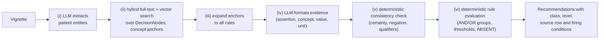

# ExecutableKG

[](https://github.com/dieterich-lab/ExecutableKG/actions/workflows/reproduce.yml)

Code, data and results for the paper

> Calik E, Wiesenbach P, Dieterich C. **Building an Executable Knowledge Graph for Clinical Decision Support in Cardiology.** Submitted to Medical Informatics Europe (MIE) 2027.

All 31 recommendation tables of the 2024 ESC Guidelines for Chronic Coronary Syndromes (CCS) are encoded as 196 executable rules in a Neo4j knowledge graph (KG). An LLM only extracts and normalises patient findings; a deterministic check aligns their certainty and qualifiers with each rule condition, and the rules are evaluated in Python. The repository compares this KG with row-level vector retrieval-augmented generation (VectorRAG) on 100 synthetic patient vignettes.

## Results (paper, Table 1)

100 vignettes; reference: 351 vignette–rule pairs, 48 vignettes without an applicable rule.

| | KG + qwen3:32b | VectorRAG + qwen3:32b | VectorRAG + gpt-5.6-luna |
|---|---|---|---|
| TP / FP / FN | 309 / 194 / 42 | 36 / 350 / 315 | 33 / 100 / 318 |
| Precision / recall / F1 (micro) | 0.614 / 0.880 / 0.724 | 0.093 / 0.103 / 0.098 | 0.248 / 0.094 / 0.136 |
| Exact row-set match (near / synonym / paraphrase) | 50 (32 / 12 / 6) | 1 (1 / 0 / 0) | 16 (8 / 6 / 2) |
| Vignettes with unsupported output | 41 | 96 | 66 |
| Correct abstention (of 48) | 35 | 1 | 15 |

Exact match, McNemar exact test on discordant vignettes: KG vs VectorRAG + qwen3:32b 49 vs 0, KG vs VectorRAG + gpt-5.6-luna 38 vs 4 (both p < 0.001). Every number can be recomputed offline from the files in this repository (see [Reproduce the paper numbers](#reproduce-the-paper-numbers-offline)).

## How the KG answers a vignette



The LLM acts only in steps (i) and (iv) and never decides whether a rule holds.

| Step | Code |
|---|---|
| (i), (iv) prompts | `src/cardio_graph_core/query/baml_src/query.baml` |
| (ii), (iii) retrieval and rule expansion | `src/cardio_graph_core/query/run_logic_query.py` |
| (iv) evidence building, (vi) rule evaluation | `src/cardio_graph_core/query/logic_evaluator.py` |
| (v) consistency check | `src/cardio_graph_core/query/consistency_filters.py`, used by `verified_logic_evaluator.py` |
| LLM answer cache and failure log | `src/cardio_graph_core/query/cached_logic_evaluator.py` |

## Repository layout

```
src/cardio_graph_core/   KG package
  neo4j/                 load the rule tables into Neo4j, SNOMED CT synonyms, grounding text and indexes
  query/                 KG query pipeline (steps i-vi) and gold-standard evaluation
  table_parsing/         SNOMED CT annotation of the rule tables (index / validate / apply)
  snomedct/              read access to a local SNOMED CT release in PostgreSQL (optional)
config/                  graph schema used by the loader
vectorrag/               VectorRAG baseline (separate Python package, see vectorrag/README.md)
data/                    rule tables, annotation index, vignettes, reference, vector index (see data/README.md)
results/                 predictions and metrics of all three arms (see results/README.md)
analysis/                scripts that compute every number in the paper
scripts/                 shell entry points (offline reproduction, graph build, KG and VectorRAG runs)
tests/                   offline unit tests of the KG package
```

## Reproduce the paper numbers (offline)

Needs Python ≥ 3.11 and, for the VectorRAG tests, `numpy` and `pydantic`. No graph, LLM or network access is needed.

```bash
pip install numpy pydantic
bash scripts/reproduce_offline.sh
```

The script runs the unit tests of both packages and then

1. checks that the VectorRAG index catalogue equals a fresh export of the rule tables, recomputes the reference rows from the rule tables and vignettes (`analysis/compute_fully_satisfied_rules.py`) and the merged-code sensitivity reference (`analysis/harmonise_reference.py`) and checks that both equal the shipped files;
2. re-applies the consistency check (step v) to the stored KG trace (`analysis/kg_posthoc_filters.py`) and checks that the result equals `results/kg/predictions_verified.jsonl.gz`;
3. prints Table 1 with `analysis/compare_arms.py`;
4. writes every number quoted in the paper to `paper_numbers.json` (`analysis/verify_paper_numbers.py`), including KG statistics, retrieval figures, McNemar tests, LLM call counts and the error attribution (`results/kg/error_analysis.csv`, one line per KG error).

## Rerun the pipelines

### Requirements

- Neo4j 5 with Cypher vector indexes (`CREATE VECTOR INDEX`, recent 5.x releases); no plugins needed
- [Ollama](https://ollama.com) with `qwen3:32b` (LLM steps) and `qwen3-embedding:4b` (embeddings)
- Python 3.11+; `pip install -e .` installs `neo4j`, `click`, `pyyaml`, `pydantic` and `baml-py` (`pip install -e ".[snomed]"` adds the PostgreSQL client for the SNOMED CT step)
- optional: a SNOMED CT release loaded into PostgreSQL (synonyms in the grounding text; SNOMED CT is licensed, bring your own release, see [NOTICE.md](NOTICE.md))
- optional: an OpenAI API key for the gpt-5.6-luna VectorRAG arm

```bash
pip install -e .                                               # KG package
pip install -e vectorrag                                       # VectorRAG package
baml-cli generate --from src/cardio_graph_core/query/baml_src  # generates query/baml_client
cp .env.example .env    # then edit; never commit .env
set -a; source .env; set +a
```

### Build the graph

```bash
bash scripts/build_graph.sh
```

loads the 31 tables in `data/rule_tables/` (`neo4j/grounding_index_to_neo4j.py --tables-dir`), optionally copies SNOMED CT synonyms onto the Concept nodes (`neo4j/sync_snomed_synonyms.py`) and builds the grounding text, embeddings and the full-text and vector indexes over DecisionNodes (`neo4j/setup_decisionnode_grounding.py`).

### Run the KG on the 100 vignettes

```bash
bash scripts/run_kg.sh results/kg_rerun
```

runs `run_logic_query.py` with the paper settings (top 50 full-text and vector hits, cosine ≥ 0.80, 3 concept groups per entity) and the default logic module `verified_logic_evaluator` (steps i-vi), then scores the run next to the paper run. With `REPLAY_PAPER_LLM=1` the run starts from the LLM answers of the paper run (`results/kg/llm_cache.jsonl`); calls whose input differs, for example after a change in retrieval, still go to the LLM. The run can be resumed after an interruption without repeating successful LLM calls.

The paper run executed steps (i)-(iv) and (vi) with `cached_logic_evaluator`; step (v) was then applied to its stored trace with `analysis/kg_posthoc_filters.py`, which re-evaluates every rule with the same code as `verified_logic_evaluator`. Step (v) was written after inspecting the errors of the run without it. It removed no reference pair, and its cue lists are generic and name no disease; the paper's Limitations note that it needs confirmation on new data.

### Run VectorRAG

```bash
bash scripts/run_vectorrag.sh qwen    # or: gpt (needs OPENAI_API_KEY)
```

uses the frozen index in `data/vector_index/` and the frozen top-12 retrieval snapshot in `results/vectorrag_qwen/retrieval_top12.jsonl`, so both generators see identical rows.

### Evaluate a new run

```bash
python3 analysis/compare_arms.py data/reference/gold_fully_satisfied.jsonl \
    kg=results/kg_rerun/predictions.jsonl \
    rag_qwen=results/vectorrag_qwen/qwen_predictions.jsonl \
    rag_gpt=results/vectorrag_gpt/gpt_predictions.jsonl --out compare_arms_metrics.json
```

## Scope

This repository contains what the paper's KG–VectorRAG comparison needs. The discharge-letter audit reported in the paper uses non-public patient data; its data and code are not part of this repository. The ESC guideline PDFs and SNOMED CT release files are not included.

## Licence and citation

Code is released under the [MIT licence](LICENSE). The rule tables reproduce recommendation text of the 2024 ESC Guidelines and contain SNOMED CT identifiers and terms; see [NOTICE.md](NOTICE.md) for what applies to the data. If you use this repository, please cite the paper (see [CITATION.cff](CITATION.cff)).

Contact: Emre Calik (emre.calik@stud.uni-heidelberg.de), Christoph Dieterich (christoph.dieterich@uni-heidelberg.de).
