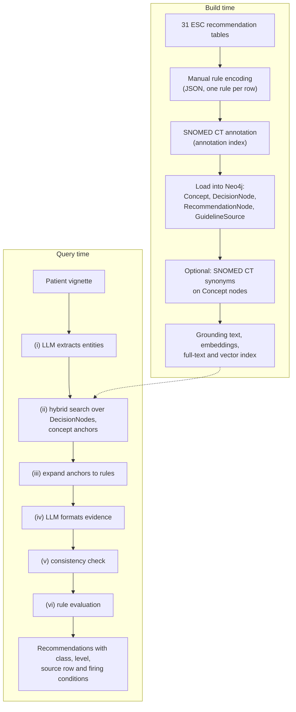
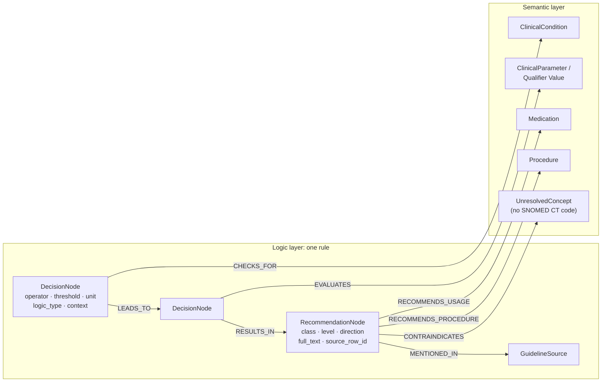
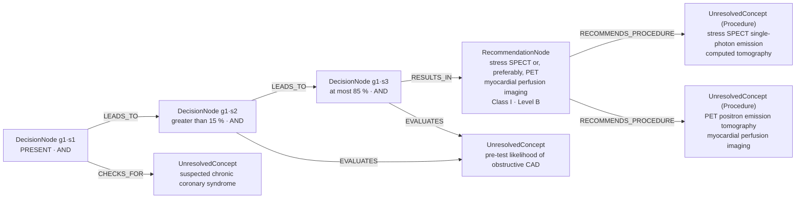
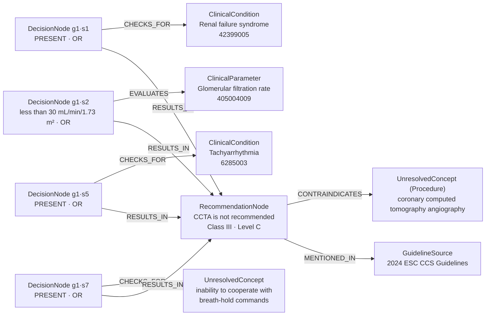

# ExecutableKG

[](https://github.com/dieterich-lab/ExecutableKG/actions/workflows/reproduce.yml)

**An executable knowledge graph for clinical decision support in cardiology.** All 31 recommendation tables of the 2024 ESC Guidelines for Chronic Coronary Syndromes (CCS) are encoded as 196 executable rules in a Neo4j knowledge graph (KG). A large language model (LLM) only turns free text into coded patient findings; whether a recommendation applies is decided by deterministic code, and every answer points back to its source row in the guideline.

This repository holds the code, data and results of the paper

> Calik E, Wiesenbach P, Dieterich C. **Building an Executable Knowledge Graph for Clinical Decision Support in Cardiology.** Submitted to Medical Informatics Europe (MIE) 2027.

---

## Contents

- [Overview](#overview)
- [Concept](#concept)
- [System architecture](#system-architecture)
- [From guideline table to executable rule](#from-guideline-table-to-executable-rule)
- [Graph schema](#graph-schema)
- [Building the graph](#building-the-graph)
- [How a patient case is answered](#how-a-patient-case-is-answered)
- [Worked examples](#worked-examples)
- [VectorRAG baseline](#vectorrag-baseline)
- [Evaluation](#evaluation)
- [Results](#results)
- [Repository layout](#repository-layout)
- [Reproduce the paper numbers (offline)](#reproduce-the-paper-numbers-offline)
- [Rerun the pipelines](#rerun-the-pipelines)
- [Configuration](#configuration)
- [Limitations](#limitations)
- [Scope, licence and citation](#scope-licence-and-citation)

---

## Overview

Clinical practice guidelines condense evidence into recommendations whose applicability depends on combinations of findings, thresholds and exclusions: *"CCTA is not recommended in patients with severe renal failure (eGFR < 30 mL/min/1.73 m²), decompensated heart failure, …, fast irregular heart rate, …"* (Class III, Level C). LLMs apply such conditional logic inconsistently, and retrieval-augmented generation (RAG) still lets the model decide whether a retrieved recommendation applies.

This project separates the two jobs:

| Job | Done by |
|---|---|
| Reading free text: which findings does the patient have, with which values? | an LLM (qwen3:32b), in two narrow steps |
| Deciding which recommendations apply | Python code executing the rules stored in the graph |

On 100 synthetic patient vignettes the KG recovered 88.0% of the applicable rules (precision 0.614, micro-F1 0.724), against micro-F1 0.098 and 0.136 for row-level VectorRAG with the same LLM and with gpt-5.6-luna ([Results](#results)).

---

## Concept

**A recommendation is a rule.** Each row of an ESC recommendation table says: *if* these conditions hold, *then* this action is recommended (or not recommended) with this class of recommendation and level of evidence. We encode every row as a rule with explicit conditions, logic and actions, ground the concepts in SNOMED CT where possible, and store the rules in a graph.

**The LLM translates, the graph decides.** Free-text patient descriptions are messy; rule logic is not. The LLM is restricted to extracting patient findings (step i) and expressing each finding as structured evidence (step iv). A deterministic consistency check (step v) and a rule evaluator (step vi) then decide which rules hold. The LLM never sees a rule's logic and never chooses a recommendation.

**Every answer is traceable.** A fired rule is returned with its recommendation text, class, level, source table row and the conditions that fired it. A wrong answer can therefore be traced to the step that produced it (extraction, grounding, normalisation or encoding), and errors of a known kind can be blocked deterministically.

Design principles:

- **Deterministic rule evaluation**: presence, absence, numeric thresholds and AND/OR logic are evaluated by code.
- **Traceability**: stable row identifiers link every rule, prediction and reference label to the guideline row.
- **Semantic interoperability**: concepts are grounded in SNOMED CT; uncoded concepts keep their guideline wording.
- **Narrow LLM use**: two prompts with structured output at temperature 0; every answer is cached and every failure logged.

---

## System architecture



---

## From guideline table to executable rule

### Rule encoding

A clinical domain expert encoded each row of the 31 tables as one rule in JSON (`data/rule_tables/`, one file per table). Each row keeps the guideline text (`Table Header`, `Section Header`, `Subheader`, `Recommendations`, `Class a`, `Level b`), a free-text summary of its conditions (`input`) and of its action (`recommendation`), and the structured encoding:

- **conditions**: what must hold for the patient;
- **actions**: what is recommended, with class of recommendation (`strength`), level of evidence (`level`) and `direction` (POSITIVE, or NEGATIVE for "is not recommended").

Two equivalent layouts occur: 76 rows hold `rules: [{"conditions": [...], "actions": [...]}]`, 120 rows hold the conditions in `rules` and the actions in a row-level `actions` list. The loader and all scripts read both.

Every condition and action is an entity object:

| Field | Meaning |
|---|---|
| `entity_original` | wording in the guideline, e.g. `fast irregular heart rate` |
| `entity_standardized_list` | SNOMED CT concept(s): `entity_standardized_candidate` (concept name) and `snomed_id`; empty if no concept fits |
| `context` | the surrounding guideline phrase, e.g. `patients with severe renal failure (eGFR <30 mL/min/1.73 m2)` |
| `role` | `ClinicalCondition`, `ClinicalParameter`, `Medication`, `Procedure` or `Qualifier Value` |
| `logic_structured` | `operator` (PRESENT, ABSENT, or a numeric comparison with `threshold` and `unit`), `logic_type` (AND / OR), `logic_group` (e.g. `and_1`, `or_1`); actions also carry `strength`, `level`, `direction` |

**Logic.** Within a rule, all AND conditions must hold and at least one condition of each OR group must hold. A range is two numeric conditions in the same AND group: *"moderate or high (> 15%–85%) pre-test likelihood"* becomes `> 15 %` AND `≤ 85 %`.

Example: Recommendation Table 8, row 2 (*"CCTA is not recommended in patients with severe renal failure (eGFR < 30 mL/min/1.73 m²), decompensated heart failure, extensive coronary calcification, fast irregular heart rate, severe obesity, inability to cooperate with breath-hold commands, or any other conditions that can make obtaining good imaging quality unlikely"*), shortened to three of its eight OR conditions:

```json
{
  "Class a": "III",
  "Level b": "C",
  "rules": [{
    "conditions": [
      {"entity_original": "eGFR",
       "entity_standardized_list": [{"entity_standardized_candidate": "Glomerular filtration rate", "snomed_id": "405004009"}],
       "context": "patients with severe renal failure (eGFR <30 mL/min/1.73 m2)",
       "role": "ClinicalParameter",
       "logic_structured": {"operator": "<", "threshold": "30", "unit": "mL/min/1.73 m^2", "logic_type": "OR", "logic_group": "or_1"}},
      {"entity_original": "fast irregular heart rate",
       "entity_standardized_list": [{"entity_standardized_candidate": "Tachyarrhythmia", "snomed_id": "6285003"}],
       "role": "ClinicalCondition",
       "logic_structured": {"operator": "PRESENT", "logic_type": "OR", "logic_group": "or_1"}},
      {"entity_original": "inability to cooperate with breath-hold commands",
       "entity_standardized_list": [],
       "role": "ClinicalCondition",
       "logic_structured": {"operator": "PRESENT", "logic_type": "OR", "logic_group": "or_1"}}
    ],
    "actions": [
      {"entity_original": "coronary computed tomography angiography",
       "context": "CCTA is not recommended",
       "role": "Procedure",
       "logic_structured": {"strength": "III", "level": "C", "direction": "NEGATIVE"}}
    ]
  }]
}
```

**The encoded guideline in numbers:** 196 rules (Class I 123, IIa 40 including three rows that split one IIa recommendation, IIb 23, III 10) with 534 condition occurrences of 277 unique input nodes (PRESENT 458, ABSENT 23, numeric thresholds 53) and 280 actions. 48 rules have a single condition; 16 have CCS as their only condition.

### SNOMED CT annotation

Concepts are annotated once per unique node, not once per occurrence. `src/cardio_graph_core/table_parsing/entity_standardization_pipeline.py` collects every unique (wording, context, role) combination into an annotation index (`data/rule_index/input_nodes.json`, `output_nodes.json`); the SNOMED CT concepts are filled in there, and `apply` writes them back into every occurrence in the tables:

```bash
python -m cardio_graph_core.table_parsing.entity_standardization_pipeline index    SOURCE_DIR INDEX_DIR
python -m cardio_graph_core.table_parsing.entity_standardization_pipeline validate INDEX_DIR
python -m cardio_graph_core.table_parsing.entity_standardization_pipeline apply    SOURCE_DIR INDEX_DIR OUTPUT_DIR
```

Concepts were mapped where an exact or close SNOMED CT concept exists: 177 of the 277 unique input nodes carry a code (67.0% of condition occurrences, 108 distinct concepts; 28.9% of actions). The other 100 keep their guideline wording and are matched by wording.

### Stable row identifiers

Every table row has an identifier `<table file>::table_<table_id>::row_<zero-based row index>`, for example `table_rec_8_manual_1.4.json::table_0::row_2`. The same identifier is used by the graph (`RecommendationNode.source_row_id`), the VectorRAG index, the reference standard and both prediction formats, so both arms are scored on identical units.

---

## Graph schema

The schema (`config/guideline_graph_schema.yaml`) separates a **semantic layer** (the vocabulary: SNOMED CT-grounded concepts) from a **logic layer** (the executable structure of each rule).



### Semantic layer

| Label | Content |
|---|---|
| `ClinicalCondition`, `ClinicalParameter`, `Medication`, `Procedure`, `Qualifier Value` | SNOMED CT-grounded concepts, merged by `snomed_id`, so a concept used by several rules exists once; properties `snomed_id`, `preferred_term`, `entity`, `entity_original`, `entity_standardized_candidate` and, after the synonym step, `snomed_synonyms` |
| `UnresolvedConcept` | concepts without a SNOMED CT code, keyed by wording and target label, so uncoded rule structure stays inspectable instead of being dropped |

The node label follows the `role` of the entity (`Other` is stored as `ClinicalCondition`). Optional `IS_A` edges between concepts can be added from a local SNOMED CT release (`--add-snomed-hierarchy`); the paper does not use them.

### Logic layer

| Label | One per | Key properties |
|---|---|---|
| `DecisionNode` | condition occurrence | `decision_id` = `<rule id>::g<group>::s<step>`, `rule_unique_id`, `operator`, `threshold`, `unit`, `logic_type`, `context`, `entity_original`, `entity_standardized_candidate`; for retrieval `grounding_text`, `grounding_aliases`, `grounding_embedding` |
| `RecommendationNode` | rule | `rule_unique_id` = `<guideline>::<table file>::table=<id>::row=<n>::rule=<k>`, `strength` (class), `level`, `direction`, `full_text`, `recommendation_type` (PRESCRIPTION for medications, DIAGNOSIS for procedures), `source`, `source_row_id` |
| `GuidelineSource` | source document | `title`, `year`, `section` |

### Relationships

| Relationship | From → to | Meaning |
|---|---|---|
| `CHECKS_FOR` | DecisionNode → ClinicalCondition | the condition tests for a disease or finding |
| `EVALUATES` | DecisionNode → ClinicalParameter and other concepts | the condition tests a measurable or other concept |
| `LEADS_TO` | DecisionNode → DecisionNode | AND conditions are chained in order; the members of an OR group are parallel branches, each linked to the next group |
| `RESULTS_IN` | DecisionNode → RecommendationNode | the end of the chain leads to the recommendation; if the rule ends with an OR group, every member of that group does |
| `RECOMMENDS_USAGE` | RecommendationNode → Medication | positive recommendation of a drug |
| `RECOMMENDS_PROCEDURE` | RecommendationNode → Procedure | positive recommendation of a procedure |
| `CONTRAINDICATES` | RecommendationNode → concept | negative recommendation (`direction` NEGATIVE) |
| `MENTIONED_IN` | RecommendationNode → GuidelineSource | provenance |

The paths (`LEADS_TO`, `RESULTS_IN`) make each rule readable in the Neo4j browser. The evaluator does not walk them: it collects all DecisionNodes of a rule and combines them by logic group (see [step vi](#vi-evaluate-the-rules-deterministic)), so evaluation does not depend on path order.

### Two rules in the graph

**AND rule: one chain, one start, one end.** 160 of the 196 rules look like this. Example: Recommendation Table 10 row 0, *"In individuals with suspected CCS and moderate or high (> 15%–85%) pre-test likelihood of obstructive CAD, stress SPECT or, preferably, PET myocardial perfusion imaging is recommended"* (Class I, Level B). Both concepts are uncoded, so they are `UnresolvedConcept` nodes; the two threshold checks share one concept node.



**OR group: parallel branches.** The other 36 rules contain an OR group with several members. The members are not chained to each other: each is a branch of its own, linked from the previous group (if any) and, when the OR group ends the rule, each with its own `RESULTS_IN` edge. Four rules consist of a single OR group, like Table 8 row 2 (four of its eight OR conditions shown):



To inspect a rule in Neo4j:

```cypher
MATCH (r:RecommendationNode {source_row_id: 'table_rec_8_manual_1.4.json::table_0::row_2'})
MATCH (d:DecisionNode {rule_unique_id: r.rule_unique_id})-[:CHECKS_FOR|EVALUATES]->(c)
RETURN r.full_text, r.strength, r.level, d.decision_id, d.operator, d.threshold, d.unit,
       d.logic_type, labels(c), c.snomed_id
ORDER BY d.decision_id
```

and to see its paths:

```cypher
MATCH (r:RecommendationNode {source_row_id: 'table_rec_8_manual_1.4.json::table_0::row_2'})
MATCH p = (d:DecisionNode {rule_unique_id: r.rule_unique_id})-[:LEADS_TO|RESULTS_IN*1..]->(r)
RETURN p
```

---

## Building the graph

`scripts/build_graph.sh` runs three steps against a Neo4j database.

**1. Load the rule tables** (`neo4j/grounding_index_to_neo4j.py --tables-dir data/rule_tables`). A preflight parses all files before anything is written and stops on inconsistencies: 31 files, 33 tables, 196 rows, 196 rule groups, all with conditions and actions. `--dry-run` runs only this check; `--preflight-report-path` writes the details (unresolved concepts, incomplete rules) as JSON. The loader then merges concepts by SNOMED CT code, creates one RecommendationNode per rule and one DecisionNode per condition, and links them as described above.

**2. SNOMED CT synonyms (optional)** (`neo4j/sync_snomed_synonyms.py`). Copies the active synonym descriptions of every coded concept from a local SNOMED CT release in PostgreSQL to `Concept.snomed_synonyms`, so that a synonym in a patient description can find the concept. SNOMED CT is licensed; bring your own release.

**3. Grounding text and indexes** (`neo4j/setup_decisionnode_grounding.py`). Each DecisionNode gets a grounding text from three auditable channels:

```text
entity_original: fast irregular heart rate
entity_standardized: Tachyarrhythmia
snomed_synonyms: <synonyms of 6285003 from the SNOMED CT release>
```

By default the guideline context is left out (`--include-context` adds it). The text is embedded with `qwen3-embedding:4b` (2,560 dimensions) and indexed twice: a full-text index (`decisionnode_grounding_fulltext_idx`) and a cosine vector index (`decisionnode_grounding_vector_idx`). The step also writes `source_row_id` onto every RecommendationNode. A hash of each grounding text is stored, so a rerun only re-embeds nodes whose text changed (`--refresh-all` re-embeds everything).

---

## How a patient case is answered

`src/cardio_graph_core/query/run_logic_query.py` runs the six steps for one question (`--question`) or a case file (`--cases`). The paper settings are the ones in `scripts/run_kg.sh`.

### (i) Extract patient entities (LLM)

`PatientInfoExtractor` (`query/baml_src/query.baml`, qwen3:32b, temperature 0) returns a list of patient-side entities. The prompt keeps measurements atomic ("LVEF < 35%" stays one entity), keeps the original wording and extracts only what is stated. The model does not see the guideline.

```text
"Patient with decompensated heart failure, fast irregular heart rate, 0.2 mV ST-segment depression on the
 resting ECG and a clinical likelihood of obstructive CAD of 90%."
→ ["decompensated heart failure", "fast irregular heart rate", "ST-segment depression 0.2 mV",
   "clinical likelihood of obstructive CAD 90%"]
```

### (ii) Ground each entity in the graph (hybrid search)

For each entity, negation words and numbers are removed (`grounding_query_text`) and the remaining text is searched in both indexes:

- **full text**: a Lucene query with the whole phrase (boost 4) OR its single tokens, top 50 DecisionNodes;
- **vector**: the embedded entity against the DecisionNode embeddings, top 50 with cosine ≥ 0.80.

The two ranked lists are fused by reciprocal rank fusion (RRF, k = 60). The hits are then collapsed into **concept anchors**: all DecisionNodes that test the same SNOMED CT concept form one group (otherwise the same standardized name, otherwise the same wording). The 3 best anchors per entity are kept (`--groups-per-entity 3`). Because an anchor is a concept rather than a single node, one match stands for every rule that tests that concept.

### (iii) Expand anchors to rules

Each anchor is expanded to all DecisionNodes that test its concept, and from there to their rules. For every rule the complete bundle is fetched: all its DecisionNodes (also those not matched by the patient), the `LEADS_TO` edges, the recommendation, the source and the actions. In the paper run a vignette retrieved 38 rules (median; range 5–164); only those whose logic holds are returned.

### (iv) Format the evidence (LLM)

For every entity–anchor pair, `PatientEvidenceFormatter` (same LLM) receives the patient mention and a summary of the anchor (concept, original wordings, contexts, operators, thresholds, units) and returns structured evidence:

```json
{"original_text": "clinical likelihood of obstructive CAD 90%",
 "standardized_concept": "pre-test likelihood of obstructive CAD",
 "present": true, "value": "90", "unit": "%", "comparator": "="}
```

The concept name is aligned to the anchor, so evidence and condition can be matched exactly in step (vi). Negated mentions ("no diabetes") produce no evidence. If a call fails, the finding is kept as present without a value (3 of 1,134 calls in the paper run); every failure is logged. With `cached_logic_evaluator` every successful answer is cached on disk, so an interrupted run resumes without repeating LLM calls. In total the KG makes 12.5 LLM calls per vignette on average (VectorRAG: 1).

### (v) Consistency check (deterministic)

The extractor and the formatter can drop a word that changes the meaning; the check recovers it from the vignette. Before a piece of evidence may support a condition, the mention is located in the vignette, and its clause (up to the next comma, "and", "with", …) is compared with the condition's concept and guideline context (`query/consistency_filters.py`):

| Check | Rule | Example |
|---|---|---|
| **certainty** | an uncertainty cue ("suspected", "possible", "suggestive of", "X is suspected", …) that scopes over the words shared by mention and condition must be present on both sides or on neither (ConText-style) | "suspected CCS" does not support "patients with established CCS"; asserted "CCS" does not support the work-up rules for suspected CCS; "documented or suspected" accepts both |
| **negation** | a mention under a negation cue in its clause never supports a condition, even if the extractor dropped the negation word (NegEx/ConText-style) | "no history of MI" does not support "history of MI" |
| **qualifier** | every qualifier of the condition (chronic / acute / subacute, stable / unstable) must also occur in the mention's clause; a more specific mention still satisfies a general condition | "myocardial ischaemia" does not satisfy "chronic myocardial ischaemia"; "chronic myocardial ischaemia" satisfies "myocardial ischaemia" |

The cue lists are generic and name no disease. In the paper run the check blocked 585 false vignette–rule pairs (379 certainty, 206 qualifier) and no reference pair. `verified_logic_evaluator.py` applies it live (the default logic module); `analysis/kg_posthoc_filters.py` applies the same code to a stored trace. `KG_FILTERS` selects the checks (`none` runs steps i–iv and vi alone).

### (vi) Evaluate the rules (deterministic)

`query/logic_evaluator.py` evaluates every DecisionNode of every retrieved rule against the evidence that passed step (v). Evidence matches a condition when its `standardized_concept` equals the condition's concept name.

| Operator | True when |
|---|---|
| `PRESENT` | matching evidence exists |
| `ABSENT` | no matching affirmative evidence exists (closed world: an unmentioned finding counts as absent) |
| `<`, `≤`, `>`, `≥`, `=`, `≠` | matching evidence has a numeric value in the same unit, and the comparison holds |

The conditions are then combined per logic group (all AND conditions, at least one OR condition, untyped conditions as required), and a rule fires only if all its groups hold. Each fired rule is returned with its recommendation (text, class, level, direction), actions, source row, and the fulfilled and unfulfilled conditions with the evidence that matched them.

### Output

One JSON record per case (`--output`); with `--include-debug` it also contains the full trace:

| Field | Content |
|---|---|
| `predicted_row_ids` | source rows of the fired rules: the system's answer |
| `recommendations` | fired rules with recommendation and actions |
| `extracted_entities`, `step0_evidence` | output of steps (i) and (iv) |
| `retrieved_row_ids`, `retrieved_rule_ids` | rules considered in step (iii) |
| `matched_nodes` (debug) | every entity → anchor match with its hits and scores |
| `rule_evaluations` (debug) | every evaluated rule with each condition's truth, reason and matched evidence, and the checks of step (v) that rejected evidence |

---

## Worked examples

Both examples come from the paper run (`results/kg/predictions_verified.jsonl.gz`).

### A correct contraindication, and a traceable error (`near_003`)

*"Patient with decompensated heart failure, fast irregular heart rate, 0.2 mV ST-segment depression on the resting ECG and a clinical likelihood of obstructive CAD of 90%."* Reference: Table 8 row 2 (CCTA is not recommended).

| Entity (i) | Anchors kept (ii) |
|---|---|
| decompensated heart failure | Heart failure (84114007); Chronic heart failure (48447003); "signs and symptoms suggestive of heart failure" |
| fast irregular heart rate | **Tachyarrhythmia (6285003)**; "signs and symptoms suggestive of heart failure"; Glomerular filtration rate (405004009) |
| ST-segment depression 0.2 mV | *"intermediate coronary artery stenosis in a proximal or mid coronary segment"*; ST segment depression (26141007); "the ventricular arrhythmia has occurred < 48 h after an MI" |
| clinical likelihood of obstructive CAD 90% | "pre-test likelihood of obstructive CAD" (15 rules); "clinical likelihood of disease"; "symptoms highly suggestive of obstructive CAD" |

The anchors expanded to 28 rules; two fired:

- **Table 8 row 2, CCTA is not recommended (Class III, Level C).** Of its eight OR conditions, `Tachyarrhythmia PRESENT` is true through "fast irregular heart rate", so the OR group and the rule hold. This is the reference row.
- **Table 13 row 5, CT-based FFR may be considered (IIb, B).** Its only condition, "intermediate coronary artery stenosis in a proximal or mid coronary segment", was the top anchor for "ST-segment depression 0.2 mV". The trace shows where the error arose: a near-miss grounding in step (ii), not the rule logic.

VectorRAG did not retrieve the reference row for this vignette; both generators instead selected Table 5 row 4 (exercise ECG is not recommended for diagnosis in patients with ≥ 0.1 mV ST-segment depression on the resting ECG), which the reference excludes because the vignette does not state suspected CCS.

### The consistency check at work (`near_001`)

*"Patient with suspected chronic coronary syndrome, a pre-test likelihood of obstructive CAD of 65% and maximum tolerated statin therapy with ezetimibe."*

The extractor returned "chronic coronary syndrome" without "suspected". Without step (v), 32 rules fired, including 16 written for *established* CCS, such as the lifestyle and risk-counselling recommendations of Table 15 (condition context: "patients with established chronic coronary syndrome"). Step (v) located the mention in the vignette, found "suspected" scoping over it, and blocked these 16 rules for certainty. The remaining 16, among them stress SPECT/PET and stress CMR perfusion imaging for suspected CCS with a pre-test likelihood of > 15–85%, equal the reference exactly.

---

## VectorRAG baseline

The comparison arm (`vectorrag/`, own package and [README](vectorrag/README.md)) embeds each table row with its inherited headers, class and level as one chunk (same embedding model, exact cosine search), retrieves the 12 most similar rows once per vignette and freezes them, and makes one generator call that may select only retrieved row identifiers (enforced by a JSON schema) or nothing. Generators: qwen3:32b (the KG's LLM) and gpt-5.6-luna.

---

## Evaluation

**Vignettes** (`data/vignettes/`). 100 one-sentence vignettes ("Patient with …", 3–4 findings, 9–39 words, thresholds as concrete values such as "an LVEF of 37%"), built from the rule index: 70 vignettes cover the 249 clinically usable input nodes once (28 workflow or availability nodes are excluded, each with a reason), 20 replace one term by a SNOMED CT synonym and 10 use a freer paraphrase. `generate_gold_cases.py` assembles them deterministically from curated clause wording; `validate_gold_cases.py` checks coverage and style.

**Reference** (`data/reference/`). `analysis/compute_fully_satisfied_rules.py` evaluates every rule against each vignette's intended input nodes: a row is in the reference when its logic holds; concepts match by SNOMED CT code or standardized name, uncoded nodes by wording; a fact the vignette does not mention is unknown, not absent. The reference has 351 vignette–row pairs; 48 vignettes have no applicable row, and 16 vignettes that mention suspected or established CCS hold 289 pairs (82%). `analysis/harmonise_reference.py` builds a sensitivity variant in which the two SNOMED CT codes used for "chronic coronary syndrome" (413844008 and 413838009) are merged.

**Metrics** (`analysis/compare_arms.py`). Micro-averaged precision, recall and F1 over vignette–row pairs; exact row-set match per vignette (paired arms compared with the exact McNemar test); vignettes with unsupported output (at least one predicted row outside the reference); correct abstention on the 48 empty vignettes. A failed vignette counts as empty output.

**Error analysis** (`analysis/kg_error_analysis.py`). Every KG error is assigned to the first step that explains it, using the run trace. False positives: *certainty* or *qualifier* (blocked by step v), *code split* (correct under the merged-code reference), *closed-world absence*, *stated* (every firing condition is stated verbatim in the vignette, but the row is not in the reference), or *grounding* (a near-miss anchor). False negatives: *reference across contexts*, *code split*, *extraction*, *grounding* or *normalisation*. One line per error is written to `results/kg/error_analysis.csv`. The categories are assigned automatically and were not reviewed clinically.

---

## Results

| | KG + qwen3:32b | VectorRAG + qwen3:32b | VectorRAG + gpt-5.6-luna |
|---|---|---|---|
| TP / FP / FN | 309 / 194 / 42 | 36 / 350 / 315 | 33 / 100 / 318 |
| Precision / recall / F1 (micro) | 0.614 / 0.880 / 0.724 | 0.093 / 0.103 / 0.098 | 0.248 / 0.094 / 0.136 |
| Exact row-set match (near / synonym / paraphrase) | 50 (32 / 12 / 6) | 1 (1 / 0 / 0) | 16 (8 / 6 / 2) |
| Vignettes with unsupported output | 41 | 96 | 66 |
| Correct abstention (of 48) | 35 | 1 | 15 |
| F1 with merged CCS codes (415 pairs) | 0.813 | 0.090 | 0.120 |

- **Exact match**: the KG matched more vignettes exactly than VectorRAG with qwen3:32b (49 vs 0 discordant vignettes) and with gpt-5.6-luna (38 vs 4); both p < 0.001 (exact McNemar test).
- **Retrieval limits VectorRAG**: the 12 retrieved rows contained 55 of the 351 reference pairs (15.7%), although 254 would fit the 12-row budget; qwen3:32b selected 36 of them and gpt-5.6-luna 33.
- **Step (v)** blocked 585 false pairs and no reference pair.
- **Remaining KG errors**: of the 194 false positives, 64 need the other CCS code, 75 have every firing condition stated in the vignette although the row is not in the reference, 53 come from near-miss grounding and 2 from closed-world absence; ten vignettes hold 75% of them. Of the 42 false negatives, 17 need the other CCS code, 13 were credited by the reference across contexts ("history of CABG" satisfying "scheduled for CABG"), 6 are grounding and 6 normalisation errors.

---

## Repository layout

```
src/cardio_graph_core/
  neo4j/                    graph build: table loader, SNOMED CT synonyms, grounding text and indexes
  query/                    query pipeline (steps i-vi), LLM prompts (baml_src/), gold-standard evaluation
  table_parsing/            SNOMED CT annotation index (index / validate / apply)
  snomedct/                 read access to a local SNOMED CT release in PostgreSQL (optional)
config/guideline_graph_schema.yaml   graph schema used by the loader
vectorrag/                  VectorRAG baseline (separate package, see vectorrag/README.md)
data/                       rule tables, annotation index, vignettes, reference, vector index (data/README.md)
results/                    predictions, traces and metrics of all three arms (results/README.md)
analysis/                   scripts that compute every number in the paper
scripts/                    reproduce_offline.sh, build_graph.sh, run_kg.sh, run_vectorrag.sh
tests/                      offline unit tests of the KG package
```

---

## Reproduce the paper numbers (offline)

Needs Python ≥ 3.11 and, for the VectorRAG parts, `numpy` and `pydantic`. No graph, LLM or network access is needed; the run takes about 30 seconds.

```bash
pip install numpy pydantic
bash scripts/reproduce_offline.sh
```

The script runs the unit tests of both packages and then

1. validates the vignettes against the rule index and checks that the VectorRAG index catalogue equals a fresh export of the rule tables;
2. recomputes the reference and the merged-code reference from the rule tables and vignettes and checks that both equal the shipped files;
3. re-applies step (v) to the stored KG trace and checks that the result equals `results/kg/predictions_verified.jsonl.gz`;
4. prints Table 1 (`analysis/compare_arms.py`);
5. writes every number quoted in the paper to `paper_numbers.json` (`analysis/verify_paper_numbers.py`): KG statistics, retrieval figures, McNemar tests, LLM call counts and the error attribution (`results/kg/error_analysis.csv`).

---

## Rerun the pipelines

### Requirements

- Neo4j 5 with Cypher vector indexes (`CREATE VECTOR INDEX`, recent 5.x releases); no plugins needed
- [Ollama](https://ollama.com) with `qwen3-embedding:4b` and `qwen3:32b` (any OpenAI-compatible server works for the LLM steps)
- Python 3.11+; `pip install -e .` installs `neo4j`, `click`, `pyyaml`, `pydantic` and `baml-py` (`pip install -e ".[snomed]"` adds the PostgreSQL client for the SNOMED CT synonym step)
- optional: your own SNOMED CT release loaded into PostgreSQL; an OpenAI API key for the gpt-5.6-luna arm

```bash
pip install -e .                                               # KG package
pip install -e vectorrag                                       # VectorRAG package
baml-cli generate --from src/cardio_graph_core/query/baml_src  # generates query/baml_client
cp .env.example .env                                           # then fill in; never commit .env
set -a; source .env; set +a
```

### Build the graph, run the KG, run VectorRAG

```bash
bash scripts/build_graph.sh                      # add --clear-graph for a fresh database
bash scripts/run_kg.sh results/kg_rerun          # REPLAY_PAPER_LLM=1 reuses the paper's LLM answers
bash scripts/run_vectorrag.sh qwen               # or: gpt
```

`run_kg.sh` uses the paper settings (top 50 full-text and vector hits, cosine ≥ 0.80, 3 anchors per entity, steps i–vi), resumes interrupted runs without repeating successful LLM calls, and scores the run next to the paper run. With `REPLAY_PAPER_LLM=1` it starts from the LLM answers of the paper run (`results/kg/llm_cache.jsonl`); calls whose input differs, for example after a change in retrieval, still go to the LLM. `run_vectorrag.sh` reuses the frozen top-12 snapshot so both generators see identical rows.

A single question:

```bash
PYTHONPATH=src python -m cardio_graph_core.query.run_logic_query \
    --question "Patient with chronic coronary syndrome and an LVEF of 30%" \
    --output answer.jsonl --include-debug
```

The paper run executed steps (i)–(iv) and (vi) with `cached_logic_evaluator`; step (v) was then applied to its stored trace with `analysis/kg_posthoc_filters.py`, which uses the same check code as `verified_logic_evaluator`. Step (v) was written after inspecting the errors of the run without it; it removed no reference pair, and its cue lists are generic and name no disease.

### Evaluate a new run

```bash
python3 analysis/compare_arms.py data/reference/gold_fully_satisfied.jsonl \
    kg=results/kg_rerun/predictions.jsonl \
    rag_qwen=results/vectorrag_qwen/qwen_predictions.jsonl \
    rag_gpt=results/vectorrag_gpt/gpt_predictions.jsonl --out compare_arms_metrics.json
```

---

## Configuration

All settings come from environment variables (template: [.env.example](.env.example)); no credentials are stored in the code.

| Variable | Used for |
|---|---|
| `NEO4J_URI`, `NEO4J_USER`, `NEO4J_PASSWORD`, `NEO4J_DATABASE` | graph build and query |
| `KG_LLM_BASE_URL` | OpenAI-compatible endpoint serving qwen3:32b for steps (i) and (iv) |
| `OLLAMA_EMBED_BASE_URL`, `OLLAMA_EMBED_MODEL` | embeddings (grounding indexes, VectorRAG) |
| `KG_LLM_CACHE`, `KG_LLM_FAIL_LOG`, `KG_STRICT_LLM` | LLM answer cache, failure log, and whether a failed formatter call fails the case |
| `KG_FILTERS` | checks of step (v): `certainty,negation,qualifier` (default), add `absence` for explicit absence, `none` to skip step (v) |
| `OLLAMA_BASE_URL`, `OLLAMA_MODEL`, `OPENAI_API_KEY`, `OPENAI_MODEL` | VectorRAG generators |
| `SNOMED_DB_HOST`, `SNOMED_DB_PORT`, `SNOMED_DB_USER`, `SNOMED_DB_PASSWORD`, `SNOMED_DB_NAME` | optional SNOMED CT release in PostgreSQL |

---

## Limitations

- The vignettes are synthetic and built from the KG's own input nodes, and the reference derives from the same rules: the evaluation measures how well each system applies the encoded rules, not whether the encoding is clinically correct.
- Grounding is the weakest step: near-miss anchors ("angina" grounded as Prinzmetal angina) and inconsistent coding of the same finding (two SNOMED CT codes for CCS) cause most remaining errors. SNOMED CT is used for concept identity, not yet for matching along its hierarchy.
- The pipeline looks no further than a mention's clause, and 100 uncoded input nodes are matched by wording.
- At query time ABSENT conditions use closed-world semantics, while the reference treats unmentioned facts as unknown.
- Step (v) was developed on the errors of this run; it removed no reference pair but needs confirmation on new data.

---

## Scope, licence and citation

This repository contains what the paper's KG–VectorRAG comparison needs. The discharge-letter audit reported in the paper uses non-public patient data; its data and code are not part of this repository. The ESC guideline PDFs and SNOMED CT release files are not included.

Code is released under the [MIT licence](LICENSE). The rule tables reproduce recommendation text of the 2024 ESC Guidelines and contain SNOMED CT identifiers and terms; see [NOTICE.md](NOTICE.md) for what applies to the data. This is research software, not a medical device.

If you use this repository, please cite the paper ([CITATION.cff](CITATION.cff)).

**Contact:** Emre Calik ([emre.calik@stud.uni-heidelberg.de](mailto:emre.calik@stud.uni-heidelberg.de)) and Christoph Dieterich ([christoph.dieterich@uni-heidelberg.de](mailto:christoph.dieterich@uni-heidelberg.de)), Klaus Tschira Institute for Integrative Computational Cardiology and Department of Internal Medicine III, University Hospital Heidelberg.
