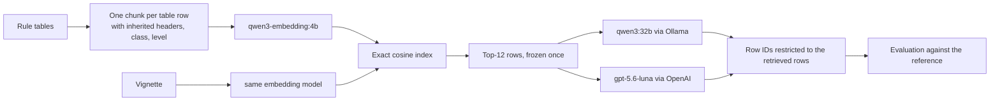

# VectorRAG baseline

Row-level vector retrieval-augmented generation over the 31 recommendation tables, used as the comparison arm in the paper. Each vignette gets dense retrieval followed by exactly **one generator call**; there are no retries, re-rankers, citation repair or follow-up calls.



## Design

- **One chunk per row.** The reference and all citations are table rows. A chunk repeats the row's table header, section header, subheader, class and level, because rows such as "• lipid profile…" only make sense with their headers (`src/vectorrag/tables.py`).
- **Exact search.** A normalised NumPy matrix with exact cosine search: deterministic and free of approximate-nearest-neighbour settings (`src/vectorrag/index.py`).
- **Frozen retrieval.** Retrieval runs once and is saved with the index fingerprint; both generators read the same snapshot, and generation refuses a snapshot from a different index (`src/vectorrag/pipeline.py`).
- **Constrained output.** The JSON schema of each call restricts row IDs to that vignette's retrieved rows, and the model may return nothing. Table metadata and recommendation text are filled in from the catalogue, never by the model; invented IDs would be reported under `invalid_cited_row_ids` (`src/vectorrag/generation.py`, `schema.py`). The OpenAI arm uses the Responses API with strict JSON-schema output and `store: false`.

## Install

Python 3.11 or newer.

```bash
pip install -e vectorrag      # from the repository root
```

## Reproduce the paper runs

From the repository root, with `OLLAMA_BASE_URL`/`OLLAMA_EMBED_BASE_URL` (and `OPENAI_API_KEY` for the gpt arm) set as in `.env.example`:

```bash
bash scripts/run_vectorrag.sh qwen
bash scripts/run_vectorrag.sh gpt
```

This calls `run_gold_benchmark.py`, which converts `expected_fully_satisfied_row_ids` of `data/reference/gold_standard_with_full_rules.jsonl` into the `expected_row_ids` contract, checks every reference row against the index catalogue, reuses the frozen snapshot `retrieval_top12.jsonl`, runs the generator and evaluates. Defaults: `qwen3:32b` with thinking off, `gpt-5.6-luna` with reasoning effort `medium`, top-k 12.

## Command-line tool

The individual steps are available as `vectorrag <command>` (or `python -m vectorrag`):

```bash
vectorrag export-catalog --tables data/rule_tables --output row_catalog.jsonl
vectorrag build-index    --tables data/rule_tables --index-dir my_index          # calls the embedding model
vectorrag validate-gold  --gold GOLD.jsonl --catalog data/vector_index/row_catalog.jsonl
vectorrag retrieve-batch --index-dir data/vector_index --cases CASES.jsonl --top-k 12 --output retrieval.jsonl
vectorrag generate-batch --index-dir data/vector_index --retrievals retrieval.jsonl --provider ollama --output pred.jsonl
vectorrag evaluate       --predictions pred.jsonl --gold GOLD.jsonl --catalog data/vector_index/row_catalog.jsonl --output metrics.json
```

`vectorrag evaluate` reports exact row-set match, macro and micro precision/recall/F1, retrieval recall@k, invalid citations and per-case values. Any prediction file with `case_id`, `status`, `retrieved_row_ids`, `predicted_row_ids` and `invalid_cited_row_ids` can be scored, including KG output.

## Offline tests

The tests use the three sample tables in `examples/tables/` and contact no model:

```bash
cd vectorrag && PYTHONPATH=src python -m unittest discover -s tests -v
```

`examples/` also holds a gold-standard template and record schema and the sample row catalogue.

## Data protection

Only synthetic vignettes were sent to the OpenAI API. Do not send identifiable patient data to an external API unless your institution's governance and data-processing terms allow it.
